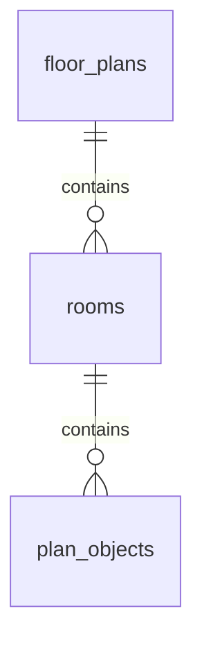
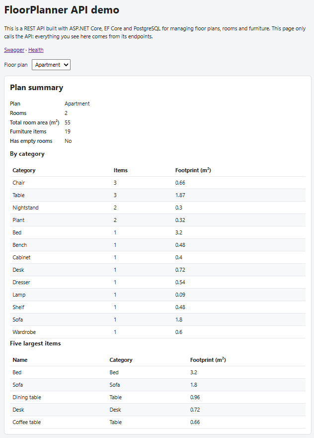
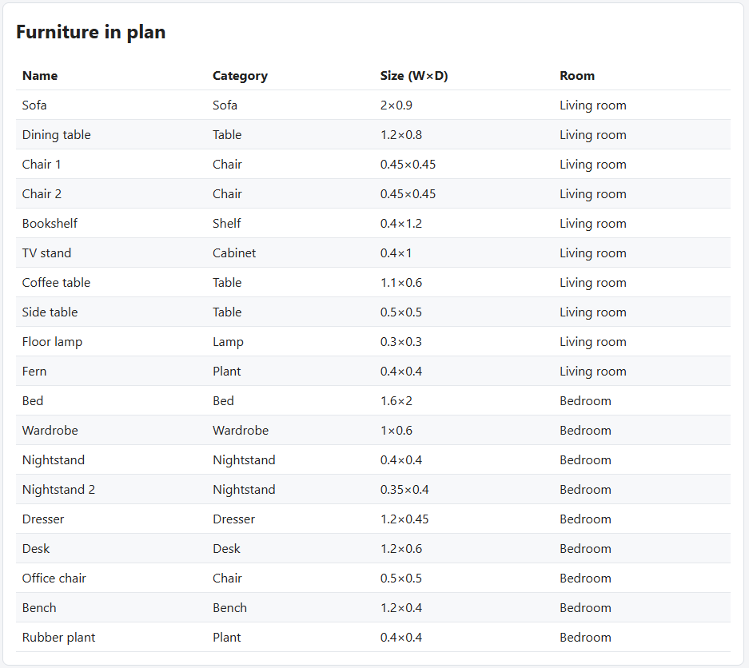
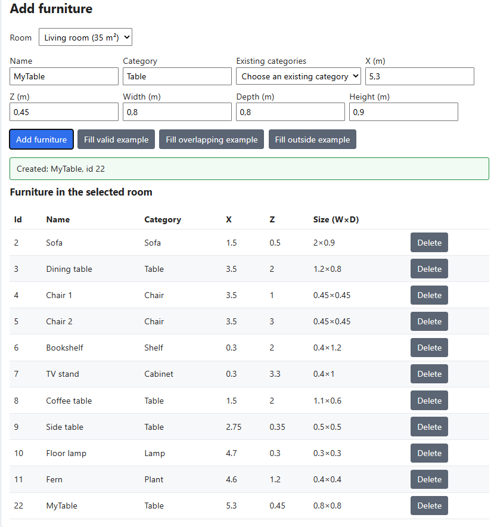
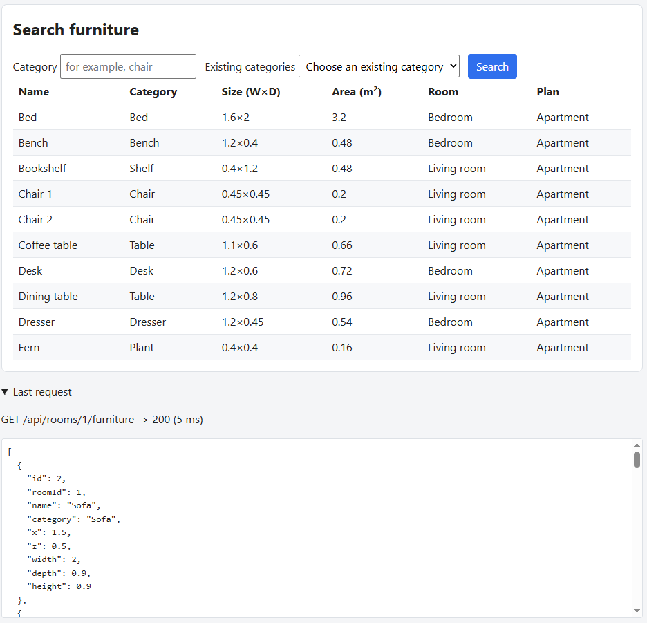

# FloorPlanner API

A REST API for managing floor plans (rooms, doors, windows, furniture) with automatic validation of furniture placement. Built with ASP.NET Core 11, EF Core and PostgreSQL. The pure domain logic (geometry, area calculation, placement rules) lives in a separate library with no framework dependencies.

## How to try the application (step by step)

No programming knowledge is needed, and the .NET SDK does not have to be installed. The instructions are for Windows 10 or 11; the first start takes about 10 to 15 minutes, mostly because of the downloads. An internet connection is required.

1. **Install Docker Desktop** (it runs the database and the application): https://www.docker.com/products/docker-desktop/. Start it and wait until its window shows **Engine running**.
2. **Download the project**: on its GitHub page press the green button **Code**, then **Download ZIP**. Right-click the downloaded file and choose **Extract All**.
3. **Open a command window in the project folder**: open the extracted folder in File Explorer (the right folder contains the file `docker-compose.yml`), click the address bar at the top, type `cmd` and press **Enter**.
4. **Start everything with one command**: type it and press **Enter**. Wait for the line `Application started` and leave this window open.

   ```bash
   docker compose up --build
   ```

5. **Open the demo page** in a browser: http://localhost:5080. It already shows a ready floor plan "Apartment" with two furnished rooms.
6. **Try it** (details in "Demo UI" below):
   1. look at the tables **Plan summary** and **Furniture in plan**;
   2. in the section **Add furniture** press **Fill valid example**, then **Add furniture**: a green message "Created" appears;
   3. press **Fill overlapping example**, then **Add furniture**: a red message says that the furniture overlaps another item;
   4. press **Fill outside example**, then **Add furniture**: a red message says that the furniture is outside the room;
   5. press **Delete** next to the item that you have added;
   6. in the section **Search furniture** type `chair` and press **Search**;
   7. optionally, open http://localhost:5080/swagger to see all the requests that the application offers.
7. **Stop the application**: click the command window and press **Ctrl+C**, then type `docker compose down`. Your data is kept; to delete it and start with the initial data again, type `docker compose down -v` instead.

### If something goes wrong

| What you see | What to do |
| --- | --- |
| `docker` "is not recognized" | Docker Desktop is not installed, or the command window was opened before the installation. Install it, close the window and repeat step 3. |
| An error mentioning `dockerDesktopLinuxEngine` | Docker Desktop is not running. Start it, wait for **Engine running** and repeat step 4. |
| `port is already allocated` or `address already in use` | Another program uses the port 5080 or 5432 (for example, a locally installed PostgreSQL, or the application is already running). Close that program and repeat step 4. |
| The page does not open | Wait until the line `Application started` appears in the command window, then refresh the page. |

## Skills shown in this project

| Skill | Where to look |
| --- | --- |
| C#, .NET | The whole solution (.NET 11) |
| .NET class library | `src/FloorPlanner.Core`: the domain logic without EF Core and ASP.NET dependencies |
| ASP.NET Core | `src/FloorPlanner.Api` |
| REST API | `src/FloorPlanner.Api/Controllers` and `Endpoints`; all the requests are listed in Swagger |
| Minimal API | `src/FloorPlanner.Api/Endpoints` (furniture CRUD, search, furniture of a plan) |
| Routing | Attribute routes in `Controllers`, route groups in `Endpoints`, route constraints (`{id:int}`) and nested routes (`api/floorplans/{planId}/rooms`) |
| CRUD applications | Floor plans and rooms (`Controllers`), furniture (`Endpoints/FurnitureEndpoints.cs`) |
| Middleware | `src/FloorPlanner.Api/Middleware/ExceptionHandlingMiddleware.cs` |
| Dependency injection (DI) and Inversion of Control (IoC) | Registrations in `Program.cs`, constructor injection in controllers and services, test doubles in `tests/FloorPlanner.Tests/Helpers` (see "DI and IoC") |
| Object-oriented programming and design | `src/FloorPlanner.Core/Domain`: inheritance and polymorphism (`PlanObject` and `FurnitureItem`, `Door`, `Window`), encapsulation, abstractions (interfaces) |
| Generic programming | `IRepository<T>`, `EfRepository<T>`, `PagedResult<T>` |
| Data structures and collections | Polygons of rooms as lists of points (`Geometry`), grouping and sorting in `Services/PlanSummaryService.cs` |
| Exception handling, debugging, troubleshooting | Domain exceptions in `Core/Exceptions`, the exception middleware, a debugging case in [docs/debugging.md](docs/debugging.md) |
| Entity Framework Core (EF Core) | `src/FloorPlanner.Api/Data`: Fluent API configurations, relationships, table-per-hierarchy inheritance, migrations, eager loading |
| Relational database design, PostgreSQL | The tables and foreign keys (see "Database" and "Data model") |
| LINQ | `Services/FurnitureService.cs` (search with filtering, sorting and paging), `Services/PlanSummaryService.cs` |
| SQL | `src/FloorPlanner.Api/sql/report.sql`: `JOIN`, `GROUP BY`, `HAVING`, a window function (see "SQL") |
| JavaScript | The demo page, `src/FloorPlanner.Api/wwwroot/app.js` (`fetch`, no frameworks) |
| Git | The history of the repository: one commit for every step of the roadmap |
| Docker | `Dockerfile` (multi-stage build, non-root user) and `docker-compose.yml` (the database and the application) |
| `async`/`await` and `CancellationToken` | All database and file access is asynchronous; the token goes from the request down to the SQL command (see "Async and cancellation") |
| Unit tests (xUnit) | `tests/FloorPlanner.Tests`: the domain logic, the middleware, the service with hand-written test doubles, the static page (`dotnet test`) |
| Swagger (OpenAPI) | Swashbuckle: the description of all endpoints and Swagger UI (see "API documentation (Swagger)") |

## Roadmap

- **A. Core** — OOP domain model and geometry (no database)
- **B. API, DB, DI and error handling** — Web API, EF Core + PostgreSQL, repositories, exception middleware, CRUD
- **C. LINQ and SQL** — furniture search, plan summaries, reporting query
- **D. Debugging and service tests** — failing test → fix, tests with a fake repository
- **E. Demo page and Docker** — single demo page, Dockerfile and compose

## Run

There are two ways. Do not use both at the same time: they use the same port 5080.

**1. With one command** (only Docker is needed, no .NET SDK):

```bash
docker compose up --build
```

Then open http://localhost:5080 (the demo page) or http://localhost:5080/swagger. Press Ctrl+C to stop; `docker compose down -v` stops the containers and resets the data.

**2. For development** (the .NET 11 SDK is needed): the database runs in Docker, the application on your computer.

```bash
docker compose up -d db
dotnet run --project src/FloorPlanner.Api
```

If the application container of the first way is running, stop it first: `docker compose stop api`.

## Async and cancellation

When a client closes the connection, ASP.NET Core cancels the `HttpContext.RequestAborted` token of the request, and this token is what the `CancellationToken` parameter of a controller action or a Minimal API handler receives. The action passes it to the service, the service passes it on to the repository and EF Core (`ToListAsync(ct)`, `SaveChangesAsync(ct)`), and the Npgsql driver cancels the SQL command that is running in PostgreSQL. EF Core then throws `OperationCanceledException`, which `ExceptionHandlingMiddleware` turns into the status 499 without a body and logs as information, so a cancelled request is not reported as a server error.

## API documentation (Swagger)

The API uses [Swashbuckle.AspNetCore](https://github.com/domaindrivendev/Swashbuckle.AspNetCore), which generates an OpenAPI description of all endpoints from the controllers and serves it with Swagger UI. Nothing has to be written by hand: new endpoints appear in the documentation automatically.

- Swagger UI, where every endpoint can be viewed and called: http://localhost:5080/swagger
- The raw OpenAPI description (JSON): http://localhost:5080/swagger/v1/swagger.json

Swagger is controlled by the `Swagger:Enabled` setting. It is `true` in `appsettings.Development.json` (the default for `dotnet run`) and `false` in `appsettings.json`. To enable it in another environment, set the environment variable `Swagger__Enabled=true`.

## Database

The schema is created by the EF Core migration `Initial` (`src/FloorPlanner.Api/Data/Migrations`). With `Database:MigrateOnStartup` set to `true` the application applies it at startup.

Tables after the first start (`docker exec -it floorplanner-db psql -U floorplanner -d floorplanner -c "\dt"`):

```text
                   List of relations
 Schema |         Name          | Type  |    Owner
--------+-----------------------+-------+--------------
 public | __EFMigrationsHistory | table | floorplanner
 public | floor_plans           | table | floorplanner
 public | plan_objects          | table | floorplanner
 public | rooms                 | table | floorplanner
(4 rows)
```

All plan objects (furniture, doors, windows) share the `plan_objects` table (table per hierarchy); the `kind` column holds the discriminator and `category` is filled only for furniture. The room corners are stored in `rooms.corners` as `jsonb`:

```text
 Table "public.plan_objects"            Table "public.rooms"
  Column  |          Type                 Column    |          Type
----------+------------------------    ---------------+------------------------
 kind     | character varying(13)        corners       | jsonb
 category | character varying(50)
```

## DI and IoC

A dependency injection (DI) container is the object that creates the application's services and passes ready-made dependencies into their constructors. This is inversion of control (IoC): a class does not create the objects it needs with `new`, it only declares them, and the framework decides what to hand over. Code then depends on interfaces (`IRepository<T>`, `IPlacementValidator`) and is easy to replace in tests.

A service is registered with one of three lifetimes. Transient: a new instance on every request to the container. Scoped: one instance per HTTP request. Singleton: one instance for the whole life of the application.

`AppDbContext` and `EfRepository<T>` are Scoped: each request gets its own context, and its tracked changes are saved or discarded together. A `DbContext` is not thread-safe, so it must not be shared between requests. `PlacementValidator` is a Singleton because it holds no state, and one instance can safely serve all requests.

The rule: a Singleton must not depend on a Scoped service. Otherwise, the long-lived object would keep a request's context after the request has ended.

## Configuration flags

Startup behavior is controlled by configuration flags, not by the environment name.

| Flag | Environment variable | `appsettings.json` | `appsettings.Development.json` | What it does |
| --- | --- | --- | --- | --- |
| `Swagger:Enabled` | `Swagger__Enabled` | `false` | `true` | Serves the Swagger UI at `/swagger`. |
| `Database:MigrateOnStartup` | `Database__MigrateOnStartup` | `false` | `true` | Applies the EF Core migrations at startup. |
| `Database:SeedDemoData` | `Database__SeedDemoData` | `false` | `true` | Adds the demo plan "Apartment" to an empty database (after the migration). |

The demo plan "Apartment" (the Living room 7 x 5 m and the Bedroom 5 x 4 m, 19 pieces of furniture, a door and a window) is added only to an **empty** database. If the database already has a plan from an earlier version, reset it to get the current demo data: `docker compose down -v`, then start the application again (see "Run").

## Data model



## SQL

The report `GET /api/reports/room-footprint` is built with a raw SQL query (`src/FloorPlanner.Api/sql/report.sql`). For every plan it shows the rooms that have at least 0.5 m² of furniture footprint, with the number of furniture items, the total footprint and the rank of the room in its plan.

```sql
SELECT fp.name AS plan_name,
       r.name  AS room_name,
       COUNT(po.id) AS furniture_count,
       ROUND(SUM(po.width * po.depth)::numeric, 2)::float8 AS total_footprint,
       RANK() OVER (PARTITION BY fp.id ORDER BY SUM(po.width * po.depth) DESC) AS rank_in_plan
FROM floor_plans fp
JOIN rooms r ON r.floor_plan_id = fp.id
JOIN plan_objects po ON po.room_id = r.id
WHERE po.kind = 'furniture'
GROUP BY fp.id, fp.name, r.id, r.name
HAVING SUM(po.width * po.depth) >= 0.5
ORDER BY fp.name, rank_in_plan, r.name;
```

What each part does:

- **`JOIN`**: connects the three tables by the foreign keys: every plan with its rooms (`rooms.floor_plan_id`), and every room with its objects (`plan_objects.room_id`). A room without objects has no matching rows, so it does not appear in the result.
- **`WHERE po.kind = 'furniture'`**: keeps only furniture before grouping; doors and windows (other values of the `kind` discriminator) are dropped.
- **`GROUP BY`**: collapses the rows into one row per room, so the aggregate functions (`COUNT`, `SUM`) are calculated for each room separately.
- **`COUNT` and `SUM`**: the number of furniture items and the total footprint (`width * depth`) of a room. `ROUND(...::numeric, 2)::float8` rounds the sum to 2 decimals and converts it back to a floating point number.
- **`HAVING`**: filters the groups after the aggregation (unlike `WHERE`, which filters rows before it): rooms with a total footprint below 0.5 m² are dropped.
- **Window function `RANK() OVER (PARTITION BY fp.id ORDER BY ... DESC)`**: ranks the rooms inside each plan (`PARTITION BY fp.id`) by the total footprint, the largest first. Rooms with equal footprints get the same rank, and the next rank is skipped. Unlike `GROUP BY`, a window function does not collapse the rows.
- **`ORDER BY`**: sorts the result by the plan name, then by the rank, then by the room name.

## Demo UI

Start the application (see Run) and open http://localhost:5080. The page is a single static HTML page (`wwwroot/index.html` with `style.css` and `app.js`; no frameworks, no CDN, no build). It only calls the API, and the data is shown as soon as the page is opened.

### Screenshots

**Plan summary**: the totals of the plan, the statistics by category and the five largest items.



**Furniture in plan**: all the furniture of the plan with the room of every item.



**Add furniture**: the form with the list of existing categories, the three examples, the green block after a successful add and the furniture of the selected room.



**Search furniture and the last request**: the found items with their room and plan, and the raw JSON of the last call to the API. The page shows only the first page of the results (10 items, sorted by name); the API itself supports paging, sorting and filtering (`page`, `pageSize`, `sort`, `category`), for example `GET /api/furniture?page=2&pageSize=10` (try it in Swagger).



### What is on the page

- **Floor plan**: the list of the plans. Choosing a plan reloads its summary, furniture and rooms.
- **Plan summary**: the number of rooms, the total room area, the number of furniture items, whether there are empty rooms, the statistics by category and the five largest items.
- **Furniture in plan**: all the furniture of the plan, with the room of every item.
- **Add furniture**:
  - the list **Room** with the rooms of the plan and their areas (the furniture is added to the selected room);
  - the form with the fields **Name**, **Category**, **X**, **Z**, **Width**, **Depth** and **Height** (in meters; X and Z are the center of the base of the item);
  - the list **Existing categories** next to the **Category** field;
  - the buttons *Add furniture* and three examples (*Fill valid example*, *Fill overlapping example*, *Fill outside example*);
  - below the form, the table **Furniture in the selected room** with a *Delete* button for every item.
- **Search furniture**: the field **Category** with the list **Existing categories**, the button *Search* and the table of the found items; every row shows the room and the plan of the item. The search works across all the plans.
- **Last request** (at the bottom): the last call to the API (the method, the address, the status, the time) and the raw JSON of the answer.

### The Category field and the list "Existing categories"

The category is a free text: the API accepts any non-empty text of up to 50 characters, so a new category (for example, `Wine rack`) can simply be typed. To avoid typing the known ones, there is the list **Existing categories** next to the field (in the add form and in the search form):

- it always contains **all** the categories of the selected plan, whatever is typed in the text field (this is why it is a separate list and not the suggestions of the text field: the browser shows only the suggestions that match the typed text);
- choosing an item copies it into the text field, and the list returns to its first item, ready to be used again;
- the list is rebuilt from the plan summary every time the plan or its furniture changes, so a category of a newly added item appears in it.

### What you can do in a minute

1. Look at the **Plan summary** and at the **Furniture in plan** table.
2. **Add furniture** in three ways. The buttons work in the room that is selected in the list **Room** (choose the second room and press them too); they always replace the position and the sizes of the armchair (0.8 x 0.8 x 0.9 m) and fill the name and the category only if these fields are empty, so a name that you have typed is kept:
   - *Fill valid example* looks for a free place in the selected room (inside the walls, without overlapping the furniture); then *Add furniture* gives a green block "Created", the new row appears in the lists and the summary is updated. After the armchair is added, the next press finds the next free place, and when the room is full the page shows "No free place";
   - *Fill overlapping example* puts the armchair on the first piece of furniture of the room: a red block with `Reason: OverlapsObject`;
   - *Fill outside example* puts the armchair outside the room, to the left of its walls: a red block with `Reason: OutsideRoom`.
3. **Delete** the added armchairs with the *Delete* button in the table **Furniture in the selected room**.
4. **Search furniture** by category (for example, `chair`) or choose a category in the list **Existing categories**. The page shows the first page of the results; the other pages are available through the API (`page` and `pageSize`, see Swagger).

The demo data is added only to an empty database; after an update of the demo plan reset the database (see "Configuration flags").
