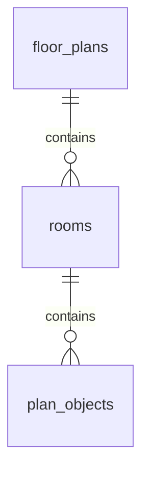

# FloorPlanner API

A REST API for managing floor plans (rooms, doors, windows, furniture) with automatic validation of furniture placement. Built with ASP.NET Core 11, EF Core and PostgreSQL. The pure domain logic (geometry, area calculation, placement rules) lives in a separate library with no framework dependencies.

## Roadmap

- **A. Core** — OOP domain model and geometry (no database)
- **B. API, DB, DI and error handling** — Web API, EF Core + PostgreSQL, repositories, exception middleware, CRUD
- **C. LINQ and SQL** — furniture search, plan summaries, reporting query
- **D. Debugging and service tests** — failing test → fix, tests with a fake repository
- **E. Demo page and Docker** — single demo page, Dockerfile and compose

## Run

```bash
docker compose up -d db
dotnet run --project src/FloorPlanner.Api
```

## API documentation (Swagger)

The API uses [Swashbuckle.AspNetCore](https://github.com/domaindrivendev/Swashbuckle.AspNetCore), which generates an OpenAPI description of all endpoints from the controllers and serves it with Swagger UI. Nothing has to be written by hand: new endpoints appear in the documentation automatically.

- Swagger UI, where every endpoint can be viewed and called: http://localhost:5080/swagger
- The raw OpenAPI description (JSON): http://localhost:5080/swagger/v1/swagger.json

Swagger is controlled by the `Swagger:Enabled` setting. It is `true` in `appsettings.Development.json` (the default for `dotnet run`) and `false` in `appsettings.json`. To enable it in another environment, set the environment variable `Swagger__Enabled=true`.

## Database

The schema is created by the EF Core migration `Initial` (`src/FloorPlanner.Api/Data/Migrations`). With `Database:MigrateOnStartup` set to `true` the application applies it at startup.

Tables after the first start (`docker exec -it floorplanner-db psql -U floorplanner -d floorplanner -c "\dt"`):

```text
                   List of relations
 Schema |         Name          | Type  |    Owner
--------+-----------------------+-------+--------------
 public | __EFMigrationsHistory | table | floorplanner
 public | floor_plans           | table | floorplanner
 public | plan_objects          | table | floorplanner
 public | rooms                 | table | floorplanner
(4 rows)
```

All plan objects (furniture, doors, windows) share the `plan_objects` table (table per hierarchy); the `kind` column holds the discriminator and `category` is filled only for furniture. The room corners are stored in `rooms.corners` as `jsonb`:

```text
 Table "public.plan_objects"            Table "public.rooms"
  Column  |          Type                 Column    |          Type
----------+------------------------    ---------------+------------------------
 kind     | character varying(13)        corners       | jsonb
 category | character varying(50)
```

## DI and IoC

A dependency injection (DI) container is the object that creates the application's services and passes ready-made dependencies into their constructors. This is inversion of control (IoC): a class does not create the objects it needs with `new`, it only declares them, and the framework decides what to hand over. Code then depends on interfaces (`IRepository<T>`, `IPlacementValidator`) and is easy to replace in tests.

A service is registered with one of three lifetimes. Transient: a new instance on every request to the container. Scoped: one instance per HTTP request. Singleton: one instance for the whole life of the application.

`AppDbContext` and `EfRepository<T>` are Scoped: each request gets its own context, and its tracked changes are saved or discarded together. A `DbContext` is not thread-safe, so it must not be shared between requests. `PlacementValidator` is a Singleton because it holds no state, and one instance can safely serve all requests.

The rule: a Singleton must not depend on a Scoped service. Otherwise, the long-lived object would keep a request's context after the request has ended.

## Configuration flags

Startup behavior is controlled by configuration flags, not by the environment name.

| Flag | Environment variable | `appsettings.json` | `appsettings.Development.json` | What it does |
| --- | --- | --- | --- | --- |
| `Swagger:Enabled` | `Swagger__Enabled` | `false` | `true` | Serves the Swagger UI at `/swagger`. |
| `Database:MigrateOnStartup` | `Database__MigrateOnStartup` | `false` | `true` | Applies the EF Core migrations at startup. |
| `Database:SeedDemoData` | `Database__SeedDemoData` | `false` | `true` | Adds the demo plan "Apartment" to an empty database (after the migration). |

## Data model



## SQL

The report `GET /api/reports/room-footprint` is built with a raw SQL query (`src/FloorPlanner.Api/sql/report.sql`). For every plan it shows the rooms that have at least 0.5 m² of furniture footprint, with the number of furniture items, the total footprint and the rank of the room in its plan.

```sql
SELECT fp.name AS plan_name,
       r.name  AS room_name,
       COUNT(po.id) AS furniture_count,
       ROUND(SUM(po.width * po.depth)::numeric, 2)::float8 AS total_footprint,
       RANK() OVER (PARTITION BY fp.id ORDER BY SUM(po.width * po.depth) DESC) AS rank_in_plan
FROM floor_plans fp
JOIN rooms r ON r.floor_plan_id = fp.id
JOIN plan_objects po ON po.room_id = r.id
WHERE po.kind = 'furniture'
GROUP BY fp.id, fp.name, r.id, r.name
HAVING SUM(po.width * po.depth) >= 0.5
ORDER BY fp.name, rank_in_plan, r.name;
```

What each part does:

- **`JOIN`**: connects the three tables by the foreign keys: every plan with its rooms (`rooms.floor_plan_id`), and every room with its objects (`plan_objects.room_id`). A room without objects has no matching rows, so it does not appear in the result.
- **`WHERE po.kind = 'furniture'`**: keeps only furniture before grouping; doors and windows (other values of the `kind` discriminator) are dropped.
- **`GROUP BY`**: collapses the rows into one row per room, so the aggregate functions (`COUNT`, `SUM`) are calculated for each room separately.
- **`COUNT` and `SUM`**: the number of furniture items and the total footprint (`width * depth`) of a room. `ROUND(...::numeric, 2)::float8` rounds the sum to 2 decimals and converts it back to a floating point number.
- **`HAVING`**: filters the groups after the aggregation (unlike `WHERE`, which filters rows before it): rooms with a total footprint below 0.5 m² are dropped.
- **Window function `RANK() OVER (PARTITION BY fp.id ORDER BY ... DESC)`**: ranks the rooms inside each plan (`PARTITION BY fp.id`) by the total footprint, the largest first. Rooms with equal footprints get the same rank, and the next rank is skipped. Unlike `GROUP BY`, a window function does not collapse the rows.
- **`ORDER BY`**: sorts the result by the plan name, then by the rank, then by the room name.
